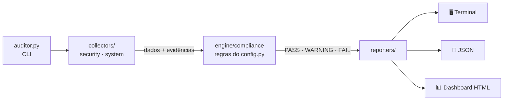

<div align="center">

# 🛡️ MacFleet Auditor


**Auditoria local de segurança e saúde operacional para macOS, em Python.**

Verifica os controles de hardening do Mac, compara o resultado com uma política de conformidade e gera evidências, prioridades de ação e um dashboard visual.


-2ea44f)


🎓 *Projeto acadêmico de Segurança da Informação*


</div>

---

## 📑 Sumário

- [Sobre o projeto](#-sobre-o-projeto)
- [Funcionalidades](#-funcionalidades)
- [Início rápido](#-início-rápido)
- [Controles auditados](#-controles-auditados)
- [Relatórios e dashboard](#-relatórios-e-dashboard)
- [Permissões e sudo](#-permissões-e-sudo)
- [Política de conformidade](#%EF%B8%8F-política-de-conformidade)
- [Arquitetura](#%EF%B8%8F-arquitetura)
- [Segurança da própria ferramenta](#-segurança-da-própria-ferramenta)
- [Testes e CI](#-testes-e-ci)
- [Aprendizados](#-aprendizados)
- [Roadmap](#%EF%B8%8F-roadmap)

---

## 📖 Sobre o projeto

Na faculdade de Segurança da Informação, recebi um desafio: escolher um entre três sistemas operacionais e desenvolver um projeto de verificação de segurança. **Escolhi o macOS** para entender como a automação pode revelar:

- configurações inadequadas de hardening;
- atualizações pendentes (*Patch Management*);
- pontos de melhoria na proteção de endpoints.

O resultado é o **MacFleet Auditor**: uma ferramenta que roda localmente, **sem dependências externas** (só a standard library do Python) e chama apenas binários nativos da Apple. A proposta não é apenas executar comandos, mas **transformar saídas técnicas em evidências, regras de conformidade e prioridades de ação** que um administrador consiga interpretar.

## ✨ Funcionalidades

- 🔐 **Hardening:** verifica FileVault, Application Firewall (incluindo Stealth Mode), Gatekeeper e System Integrity Protection (SIP).
- 🔄 **Patch Management:** lista as atualizações pendentes e separa as que são de segurança.
- 📊 **Motor de conformidade:** uma política declarativa classifica cada controle como `PASS`, `WARNING`, `FAIL` ou `SKIPPED`, com severidade e score ponderado.
- 🖥️ **Inventário (ITAM):** coleta modelo, número de série, chip, memória, versão do macOS e uptime.
- 💾 **Saúde operacional:** mede o espaço livre do disco e o compara com limites de alerta.
- 👤 **Menor privilégio:** detecta se o usuário pertence ao grupo `admin`.
- 📄 **Relatórios:** gera um resumo no Terminal, um JSON estruturado com evidências e um **dashboard HTML** que funciona offline.
- 🤖 **Pronto para automação:** os exit codes padronizados permitem integrar com MDM (Jamf, Kandji, Intune) e pipelines de CI.

## 🚀 Início rápido

**Pré-requisitos:** macOS com Python 3.9 ou superior.

```bash
python3 --version   # precisa ser 3.9+
```

> Se o macOS pedir as *Command Line Tools*, rode `xcode-select --install`.

```bash
git clone https://github.com/<seu-usuario>/macfleet-auditor.git
cd macfleet-auditor
python3 auditor.py --open
```

O comando faz a auditoria, salva os relatórios em `./reports/` e abre o dashboard no navegador.

<details>
<summary><b>📋 Exemplo de saída no Terminal</b></summary>

```text
══════════════════════════════════════════════════════════════════════
  MacFleet Auditor  v1.0.0   ·   política: MacFleet Baseline v1.0.0
══════════════════════════════════════════════════════════════════════
RESULTADOS DE CONFORMIDADE
  STATUS   ID       SEVER.    CONTROLE                               DETALHE
  · Security Hardening
  ✔ PASS   SEC-001  critical  Criptografia de disco (FileVault)      Estado 'on' conforme.
  ✔ PASS   SEC-002  high      Application Firewall ativo             Controle ativo.
  ▲ WARN   SEC-003  low       Firewall em Stealth Mode               Stealth mode desativado.
  · Patch Management
  ✖ FAIL   SEC-006  high      Atualizações de segurança pendentes    1 pendente(s) — acima do máximo (0).
  · Operational Health
  ▲ WARN   OPS-001  medium    Espaço livre no volume principal       12.48% — abaixo do ideal (> 15.0%).

RESUMO EXECUTIVO
  Status geral             NÃO CONFORME
  Regras avaliadas         10 total  ·  5 PASS  ·  4 WARNING  ·  1 FAIL  ·  0 SKIP
  Score de conformidade    50.0%  (ponderado por severidade: 79.2%)
  Relatório JSON           reports/audit_report_20261022_161956.json
  Dashboard HTML           reports/audit_report_20261022_161956.html
```

*Saída resumida, com dados de exemplo.*
</details>

### Opções da CLI

```bash
python3 auditor.py                          # auditoria completa (consulta updates ao vivo, ~30 s–3 min)
python3 auditor.py --updates-mode cached    # rápida: usa o cache local do Software Update
python3 auditor.py --updates-mode skip      # não verifica updates (as regras viram SKIPPED)
python3 auditor.py -o ~/Desktop/auditorias  # muda o diretório dos relatórios (padrão: ./reports)
python3 auditor.py --json-stdout > out.json # JSON no stdout (pipelines, MDM)
python3 auditor.py -q; echo $?              # silenciosa: só o exit code e os arquivos
python3 auditor.py --open                   # abre o dashboard ao final
python3 auditor.py --no-html                # gera apenas o JSON
```

### Exit codes

| Código | Status | Significado |
|:---:|---|---|
| `0` | `COMPLIANT` | Todas as regras passaram |
| `1` | `AT_RISK` | Há avisos e nenhuma falha |
| `2` | `NON_COMPLIANT` | Ao menos uma regra está em `FAIL` |
| `3` | Erro | SO não suportado, política inválida ou falha ao gravar o relatório |

## 🔍 Controles auditados

| ID | Controle | Severidade | PASS quando | Comando |
|---|---|:---:|---|---|
| SEC-001 | FileVault | 🔴 Crítica | Criptografia ativa (*encrypting* gera WARNING) | `fdesetup status` |
| SEC-002 | Application Firewall | 🟠 Alta | Firewall habilitado | `socketfilterfw --getglobalstate` |
| SEC-003 | Stealth Mode | ⚪ Baixa | Stealth habilitado | `socketfilterfw --getstealthmode` |
| SEC-004 | Gatekeeper | 🟠 Alta | `assessments enabled` | `spctl --status` |
| SEC-005 | System Integrity Protection | 🔴 Crítica | SIP `enabled` (configuração customizada gera WARNING) | `csrutil status` |
| SEC-006 | Updates de segurança | 🟠 Alta | 0 pendentes | `softwareupdate --list` |
| SEC-007 | Updates em geral | 🟡 Média | 0 pendentes | `softwareupdate --list` |
| OPS-001 | Espaço livre em disco | 🟡 Média | Mais de 15% livre (de 10% a 15% gera WARNING) | `df` / `shutil` |
| OPS-002 | Versão mínima do macOS | 🟡 Média | Versão ≥ 15.0 (configurável) | `sw_vers` |
| IAM-001 | Usuário sem admin | 🟡 Média | Usuário fora do grupo `admin` | `dseditgroup` |

Os controles têm como referência o **CIS Apple macOS Benchmark**, o **NIST mSCP** (macOS Security Compliance Project) e o **CIS Controls v8**. As referências de cada um aparecem no relatório.

## 📊 Relatórios e dashboard

Cada execução gera dois arquivos com o mesmo carimbo de data e hora:

| Arquivo | Conteúdo |
|---|---|
| `audit_report_AAAAMMDD_HHMMSS.json` | Metadados da execução, dados brutos coletados, saída de cada comando (evidência) e resultado de cada regra |
| `audit_report_AAAAMMDD_HHMMSS.html` | Dashboard **autocontido**: sem CDN e sem rede, abre offline com duplo clique |

**O dashboard mostra:**

- status geral, score de conformidade e atualizações pendentes;
- resultados por categoria e por severidade, com as três ações prioritárias;
- armazenamento com os limites de 15% e 10%;
- a ficha do dispositivo (modelo, serial, macOS, chip, usuário e uptime);
- uma tabela de controles com filtros e busca. Ao clicar numa linha, aparecem o valor **esperado**, o **coletado**, a **remediação**, as **referências** e a **evidência** do comando;
- tema claro/escuro, impressão em PDF e o botão **Carregar relatório** (também dá para arrastar um `.json` para a página).

Veja os exemplos em [`examples/`](examples/).

## 🔑 Permissões e sudo

**Nenhum check exige root**, porque todos apenas leem o status do sistema:

| Check | Comando | Root? |
|---|---|:---:|
| FileVault | `fdesetup status` | ❌ |
| Firewall | `socketfilterfw --getglobalstate` / `--getstealthmode` | ❌ |
| Gatekeeper | `spctl --status` | ❌ |
| SIP | `csrutil status` | ❌ |
| Updates | `softwareupdate --list --include-config-data` | ❌ |
| Hardware/serial | `system_profiler SPHardwareDataType -json` | ❌ |
| Admin | `dseditgroup -o checkmember` | ❌ |

**Quando usar `sudo python3 auditor.py`:**

- Para **reproduzir o contexto de MDM**, já que Jamf, Kandji, Intune e Mosyle rodam scripts como root.
- Como root, a ferramenta audita o **usuário certo**: o `SUDO_USER` ou, numa execução direta via MDM, o usuário logado no console.
- O relatório gerado com sudo **volta a ser do seu usuário** (`chown`), com permissão `0640`, porque contém o número de série.

> **Full Disk Access não é necessário** para os checks atuais.

## ⚙️ Política de conformidade

As regras ficam em `config.py` e são **declarativas**: para adicionar ou ajustar uma regra, não é preciso mexer no motor.

```python
{
  "id": "OPS-001", "severity": "medium",
  "source": "system.storage", "field": "free_percent",
  "operator": "min_threshold",
  "params": {"pass": 15.0, "warning": 10.0, "unit": "%"},   # >15% PASS · >10% WARNING · senão FAIL
  "remediation": "...", "references": ["..."]
}
```

| Operador | PASS quando |
|---|---|
| `is_true` / `is_false` | O valor é verdadeiro ou falso |
| `in` | O valor está na lista `pass` (ou na lista `warning`, que gera WARNING) |
| `max` | Valor ≤ limite |
| `min_threshold` | Valor > `pass` (ou > `warning`, que gera WARNING) |
| `version_gte` | Versão ≥ mínima |

O campo opcional `params.on_fail` (`FAIL` ou `WARNING`) define o peso da não conformidade.

**Para personalizar sem editar o código:**

```bash
python3 auditor.py --dump-policy > minha_politica.json   # edite limites, severidades e regras
python3 auditor.py --policy minha_politica.json
```

Se uma coleta falhar (comando ausente, timeout ou saída não reconhecida), a regra vira `WARNING` com o motivo e a auditoria continua. Esse comportamento é configurável em `on_collection_error`.

## 🏗️ Arquitetura



```
macfleet-auditor/
├── auditor.py                 # Entry point: CLI, orquestração e exit codes
├── config.py                  # Limites + política de conformidade declarativa
├── collectors/
│   ├── utils.py               # Execução segura de comandos, leitura de plist
│   ├── security.py            # FileVault, Firewall, Gatekeeper, SIP, Updates
│   └── system.py              # Hardware, serial, macOS, disco, admin, uptime
├── engine/
│   └── compliance.py          # Avalia dados x regras e calcula o score
├── reporters/
│   ├── cli.py                 # Resumo executivo no Terminal
│   ├── json_reporter.py       # Relatório estruturado (gravação atômica)
│   ├── html_reporter.py       # Dashboard com os dados embutidos
│   └── dashboard_template.html
├── tests/                     # Testes unitários (rodam em qualquer SO)
├── examples/                  # Relatório e dashboard de exemplo
└── docs/                      # Imagens do README
```

## 🔒 Segurança da própria ferramenta

Uma ferramenta de segurança também precisa ser segura:

- **Somente leitura:** nada é alterado no sistema; as remediações são apenas sugeridas.
- **Caminhos absolutos e `PATH` mínimo:** evitam *PATH hijacking* quando a execução é com sudo.
- **`LC_ALL=C`:** mantém a leitura das saídas estável em Macs configurados em português.
- **Timeout em todo comando:** uma coleta travada não derruba a auditoria.
- **Dashboard protegido contra injeção:** os dados coletados são escapados antes de entrar no HTML.
- **Relatórios fora do Git:** o `.gitignore` exclui `reports/`, porque os arquivos contêm serial e hostname.

## 🧪 Testes e CI

```bash
python3 -m unittest discover -s tests -v
```

A cada push, o **GitHub Actions** roda:

- os testes unitários no Ubuntu (Python 3.9 e 3.12);
- uma **execução real da ferramenta** num runner macOS, validando o relatório gerado.

## 💡 Aprendizados

- O desafio não é rodar comandos, e sim **interpretar** saídas que mudam entre versões do macOS e transformá-las em **evidência auditável**.
- Separar **coleta, regra e apresentação** torna a política reutilizável e fácil de testar.
- Conceitos aplicados na prática: **CIS Benchmarks**, **NIST mSCP**, **menor privilégio**, **Patch Management**, **ITAM** e **testes automatizados**.

## 🗺️ Roadmap

- [ ] Novos controles: bloqueio de tela, auto-login, Remote Login/SSH, Bluetooth Sharing, perfis MDM (`profiles status -type enrollment`), versão do XProtect e Time Machine.
- [ ] Mapeamento completo para o CIS Apple macOS Benchmark.
- [ ] Histórico de auditorias no dashboard, com a evolução do score.
- [ ] Distribuição via MDM (script + LaunchDaemon), com envio do JSON para um SIEM.
- [ ] Uso do exit code como *Extension Attribute* ou *Smart Group*.

## ⚠️ Aviso

Projeto **educacional**, desenvolvido para fins acadêmicos. Antes de usar em ambiente corporativo, valide as regras com a política de segurança da sua organização.

## 👤 Autor

**Arthur Marques**: estudante de Segurança da Informação, com interesse em Infraestrutura de TI, IT Operations, segurança de endpoints e automação com Python.

[](https://www.linkedin.com/in/<seu-perfil>)

Feedbacks e sugestões são bem-vindos. Abra uma *issue*! ⭐ Se o projeto te ajudou, deixe uma estrela.

## 📄 Licença

Distribuído sob a licença [MIT](LICENSE).
